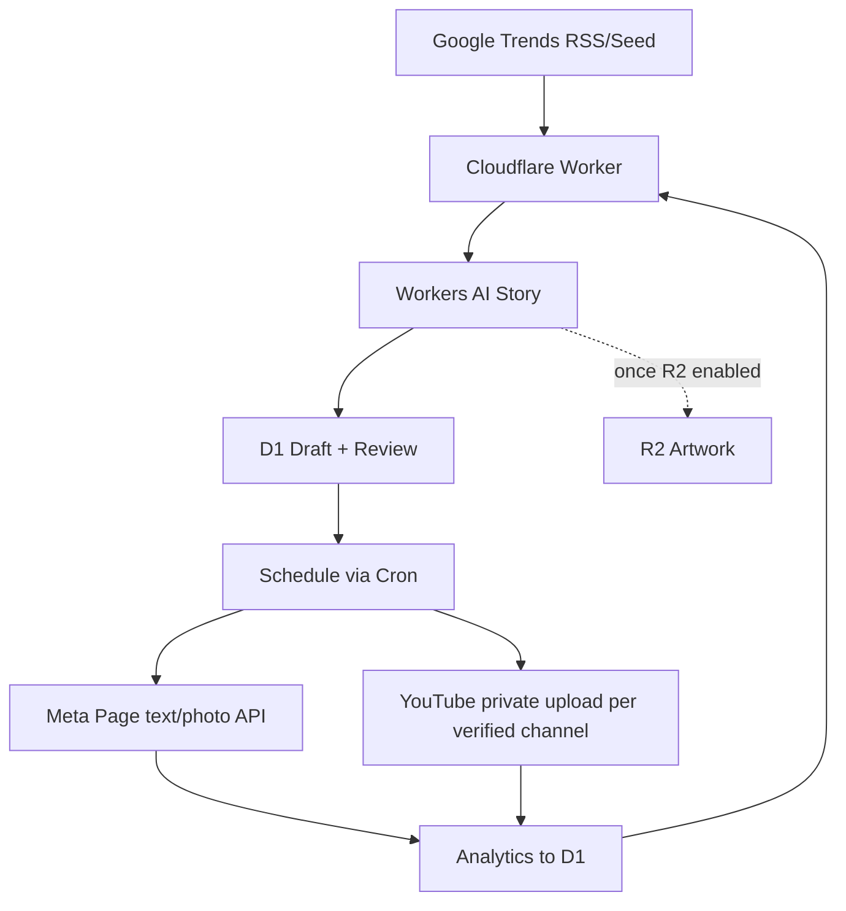

# ARSITEKTUR 1.1.2 — Ceritexa Studio
Single isolated Cloudflare Worker `ceritexa-content-agent`, D1 `ceritexa-content-db`. Optional private R2 `ceritexa-content-media` after owner enables storage.

## Code ownership
- src/core.js: channel rules, IP filter, RSS parser, AI JSON validation, security logic.
- src/index.js: Worker fetch+cron, DB, AI, API adapters, dashboard.
- tests/core.test.js: pure rules + regression.
- migrations/0001.sql: D1 schema; future schema changes require sequential migrations.
- wrangler.toml: only Ceritexa-specific resource bindings.
- .github/workflows/ci.yml: CI test-only, **no automatic production deployment**.

## Public API and admin
GET /api/health without auth; all other `/api/*` require Authorization: Bearer ADMIN_TOKEN (>=24 characters). Dashboard at /.
Admin: status, posts, trends, analytics, audit, research, generate, posts/:id/approve, schedule, media, pause, publish, metrics. No impersonation or public profile publishing.

## Safety & availability
Git history of old code remains but new HEAD tree has no old code. Default paused and publication off. Video rendering + audio/subtitles requires separate licensed renderer; the basic Worker cannot synthesize complete videos. R2 currently not enabled; MEDIAKV fallback is limited by free KV quotas and consistency. Publication and analytics adapters require secrets and account permissions and must be E2E tested before autopilot.
