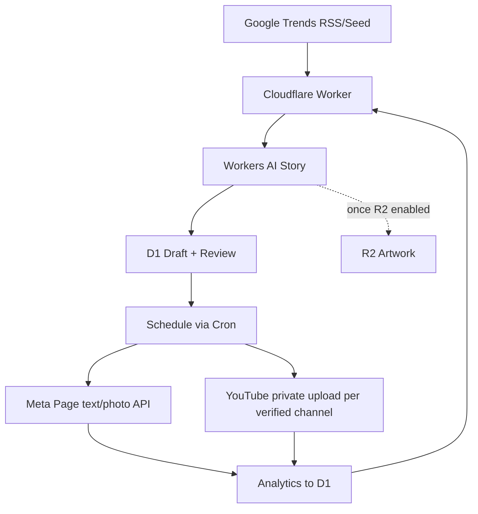

# ARSITEKTUR 1.6.0 — Ceritexa Studio
Single isolated Cloudflare Worker `ceritexa-content-agent`, D1 `ceritexa-content-db`. Optional private R2 `ceritexa-content-media` after owner enables storage.

## Code ownership
- src/core.js: channel rules, IP filter, RSS parser, AI JSON validation, security logic.
- src/index.js: Worker fetch+cron, DB, AI, API adapters, dashboard.
- tests/core.test.js: pure rules + regression.
- migrations/0001.sql: D1 schema; future schema changes require sequential migrations.
- wrangler.toml: only Ceritexa-specific resource bindings.
- .github/workflows/ci.yml: CI test-only, **no automatic production deployment**.

## Public API and admin
GET /api/health without auth; all other `/api/*` require Authorization: Bearer ADMIN_TOKEN (>=24 characters). Dashboard at /.
Admin: status, posts, trends, analytics, audit, research, generate, posts/:id/approve, schedule, media, pause, publish, metrics. No impersonation or public profile publishing.

## Safety & availability
Git history of old code remains but new HEAD tree has no old code. Default paused and publication off. Video rendering + audio/subtitles requires separate licensed renderer; the basic Worker cannot synthesize complete videos. R2 currently not enabled; MEDIAKV fallback is limited by free KV quotas and consistency. Publication and analytics adapters require secrets and account permissions and must be E2E tested before autopilot.

## Version 1.4.0 — Additive changes (single-owner files)
- Cloudflare Worker `src/index.js`: AI prompt engine, status/readiness, generated video artwork, audit, owner media upload and private preview; per-channel strategy() aggregates published engagement and updates canonical `settings.strategy_CHANNEL` only with >=3 measurable posts.
- GitHub Actions `.github/workflows/render-video.yml`: renders **draft video only** in ephemeral runner using `tools/render_video.py` (espeak-ng TTS, generated SRT, FFmpeg). It gets source image/script from the protected Worker API and sends MP4 back to existing post; it has no Facebook/YouTube token or publishing capability. Requires GitHub Actions `CERITEXA_ADMIN_TOKEN` secret; no new Cloudflare resource.
- Only `ceritexa-content-agent` script, `ceritexa-content-db` D1 and `ceritexa-content-media-kv` KV belong to this project. The `finchat-ai-gateway.workers.dev` suffix is the **Cloudflare account-wide workers.dev label**, not the application or Worker binding.
- Publication gate rejects generated image as MP4 and blocks Facebook Reels until official endpoint is implemented. YouTube upload only `privacyStatus=private` and after `mine=true` ID check.
- Cloudflare API model smoke: Gemma 4 26B A4B IT delivered valid original Indonesian JSON; Llama 3.1 8B is fallback; earlier GLM 4.7 Flash low-token response can be dominated by reasoning. Missing model output causes HOLD/error rather than invalid data.
- Neither GitHub Actions nor Worker secretly borrows API keys from Finchat/Spenva/Nusa Penida Experiences. OAuth + provider acceptance remain necessary for live posting.

## Deployed draft-only automation
Cloudflare Cron 00:00 UTC (08:00 WITA) executes metrics refresh, strategy assessment, research and one queued AI draft from a weekly Facebook/Panex/Heros rotation while `ALLOW_DAILY_DRAFTS=true`, D1 paused=false. A 24-draft/month cap applies. `ALLOW_PUBLICATION=false` is independent and is intentionally kept off. Second 15-minute Cron runs publisher only when explicit provider configuration and publication switch are enabled. Results await human review.

## v1.4.0 readiness and integration checks
- In existing src/core.js, readiness(env,paused) returns non-sensitive binding and setup checks. src/index.js publishes admin-only GET /api/readiness and GET /api/connections/verify. The latter calls Meta Page identity endpoint and Google YouTube channel identity, without publishing. Both require ADMIN_TOKEN.
- The Meta Page publisher now verifies that Graph Page ID matches FB_PAGE_ID and the returned name starts with Ceritexa before posting. Google publisher checks that Panex/Heros IDs differ and refresh token resolves to the proper channel. Misconfigured channel leads fail-closed UNCERTAIN after claim (never blind retry).
- tests/smoke.py is the one canonical external read-only HTTP check, invoked only on manual GitHub CI; tests/core.test.js remains pure unit tests. Video tool tools/render_video.py fails when script >145 words or generated narration >59s.
- All OAuth secrets are owner-configured; no token is in source/response/log. First sample draft was inserted into Ceritexa D1 as UJI INTERNAL, not posted externally.

## 2026-10-26 — Editorial topic selector source of truth
- src/core.js now owns the shared per-channel EDITORIAL_TOPICS array and selectDraftTopic() for manual/strategy/trends/fallback choice. This replaces unrestricted newest-trend selection in the existing src/index.js makeDraft(), not a duplicate agent or additional Worker.
- Relevance score is zero for topics such as a football table headline when unrelated to Heros and Panex original fiction. All existing D1 trends remain source signals; off-brand topics are never used to auto-select the next draft.
- The Worker still uses its existing AI and D1 bindings; changes deployed only to isolated ceritexa-content-agent. Cloudflare Secret names preserved, ALLOW_PUBLICATION remains false and two Cron triggers unchanged.

## v1.4.0 architecture — protected visual review, regeneration and lineage
- Additive D1 migration migrations/0002_review_feedback.sql adds one idempotent draft_reviews table keyed by post_id and backfills thumbnails from old image posts. Existing posts schema and publication contracts remain unchanged.
- Existing src/core.js owns canonical REJECTION_REASONS, MAX_REVISION_DEPTH=3, validateRejection and creativeSimilarity.
- Existing src/index.js now uses the shared saveAIArtwork for new TEXT/PHOTO/COMIC/VIDEO draft covers and for later owner-initiated artwork generation. Protected GET /api/preview/:id resolves the preview via draft_reviews.preview_media_key even after video MP4 replaces media_key. KV media never gets a public URL or token in a query string.
- Owner POST /api/posts/:id/reject atomically claims an eligible PENDING_REVIEW/BLOCKED draft, stores reason/note in draft_reviews, updates original to REJECTED, then invokes makeDraft with parent creative feedback. New child points to parent_id with increased revision_depth.
- If generation fails, regen_state is FAILED, error is audited and explicit /api/posts/:id/regenerate retry is allowed only if no child exists. Three revisions maximum. All replacement drafts require fresh owner approval.
- Original user's logo JPEG is embedded inside existing dashboard, shown in header and as cover fallback. Authenticated fetch creates disposable blob URLs for private images.
- Version 1.4.0 unit tests are appended to existing tests/core.test.js rather than creating parallel test owners.

## v1.4.0 — Isolated installable Android PWA
- Retains a SINGLE Cloudflare Worker deployment (ceritexa-content-agent). Public endpoints in existing src/index.js serve /manifest.webmanifest, /sw.js, /icon-192.svg, /icon-512.svg, /icon-96.jpg and the existing / dashboard; no separate PWA repo/build chain.
- Manifest sets app id=/, scope=/, start_url=/, standalone mode, dark theme, orientation portrait. Icons use the same Ceritexa brand image already embedded in the dashboard; SVG 192 and 512 variants plus JPEG raster fallback, served with correct MIME types. Chromium supports scalable SVG icons; actual install prompt depends on the specific browser/device.
- Client attaches link rel=manifest and progressive install instructions, handles beforeinstallprompt/appinstalled and registers service worker via navigator.serviceWorker.register('/sw.js') on secure context.
- Service worker caches strictly public / shell, manifest and icons. Navigations use network-first with offline shell fallback. Requests with Authorization, any /api/ path, non-GET actions, private media, and cross-origin URLs are NEVER intercepted/cached. Admin bearer token is kept in volatile JS memory only; offline backend actions unavailable.
- Worker HTML Content-Security-Policy extended only by worker-src 'self' and manifest-src 'self'. Scripted controls stay under existing dashboard; no changes to OAuth, D1, media KV, schedule or public posting.

## v1.4.2 — Renderer to D1 verification contract
- Existing tools/render_video.py reads BLOCKED JPEG VIDEO drafts via protected Worker API, renders with espeak-ng + ffmpeg, validates with ffprobe and uploads MP4 to the existing POST /api/posts/:id/media.
- Upload modifies post media_type to video/mp4 and state to PENDING_REVIEW. Renderer follows with GET posts verification; only then returns success. Any render error returns nonzero and is visible in GitHub step logs.
- Existing src/index.js /api/posts/:id/render-event (admin Bearer) writes RENDER_STARTED/FAILED/COMPLETED to the original audit table. Never accepts COMPLETED if D1 lacks a finished MP4. GET posts includes latest render event for dashboard display. No new database table, no new secrets.
- Existing PWA shows JPEG as cover and a prominent ▶ Putar MP4 overlay when MP4 is ready. No additional Worker and no public posting.

## v1.5.0 — Four-scene pipeline and opt-in MP4 re-render
- Existing Worker adds authenticated GET/POST /api/posts/:id/storyboard and GET /api/posts/:id/storyboard/:index/image. Plans are built in canonical src/core.js; original cover serves scene 0, three additional images are generated by the existing Workers AI image model and saved in private MEDIAKV.
- Additive migration migrations/0003_video_storyboard.sql creates the single video_storyboard table in dedicated Ceritexa D1; it does not alter/delete previous drafts. Partially generated stories are resumed, with up to 12 new scene images/day across all jobs.
- Existing GitHub tools/render_video.py requests 4 distinct JPEGs and uses Edge Indonesian neural voices (Gadis for Panex, Ardi for Heros) and neural SRT timings. If the unofficial online TTS service fails, renderer returns Failure without falling back to espeak-ng.
- FFmpeg zoompan + fade + concat produces four 540x960 shots, H264/AAC with subtitles. A synthetic 4-image render on FFmpeg 7.1.5 produced a valid MP4. Animated camera movement is NOT character animation; no paid I2V calls are made.
- Existing media upload endpoint updates only eligible BLOCKED video to PENDING_REVIEW with verified MP4, retaining story poster key in draft_reviews. Owner-only POST /api/posts/:id/upgrade-video resets an UNAPPROVED MP4 to BLOCKED/JPEG for new rendering, preserving old MP4 data in KV.
- ALLOW_PUBLICATION stays false and owner must review all replacement MP4 files. No edits to unrelated Cloudflare resources, no new provider credentials.

## v1.6.0 — Dynamic scene pipeline in the existing modules
- src/core.js sceneBeats(story,channel) derives boundaries via dramatic event and narrative transition cues, punctuation and genre pacing while retaining source words. scenePrompt embeds variable total/index and per-beat shot guidance. MAX_STORYBOARD_SCENES=24 is a technical fail-safe, not a target count.
- Migration 0004_dynamic_storyboard.sql evolves existing video_storyboard CHECK(scene_index) 0..3 to 0..63 with a staging copy-and-swap; historical records and media references preserved. No second storyboard table survives.
- Existing src/index.js storyboard POST creates at most 3 new AI images per call, allows continuation and reports progress (plannedCount, sceneCount, remaining, ready, stale, dailyLimitReached). Daily extra image budget 12 may postpone progress without shortening narrative; changed scripts cause owner-requested replan retaining KV media objects.
- Existing GitHub tools/render_video.py repeatedly builds missing storyboard images in batches, requires plannedCount unique private JPEGs, assigns each scene a spoken-word-weighted share of actual neural voice duration and composes a variable FFmpeg zoompan/fade/concat graph. Upload and D1 verification remain required for success.
- Existing PWA card and gallery show X/Y planned shots, unfinished status and no false claim of completion. Approved/published content and Cloudflare accounts for other projects are unaffected. ALLOW_PUBLICATION=false.
