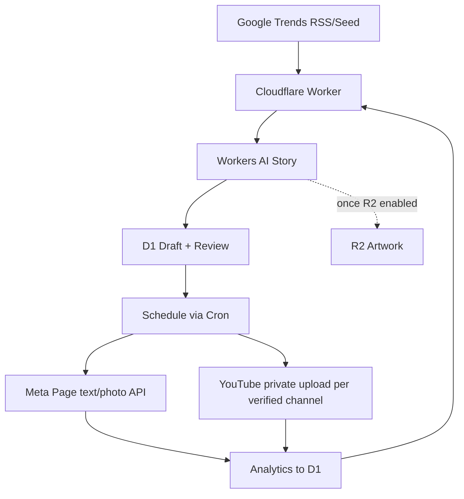

# ARSITEKTUR 1.2.2 — Ceritexa Studio
Single isolated Cloudflare Worker `ceritexa-content-agent`, D1 `ceritexa-content-db`. Optional private R2 `ceritexa-content-media` after owner enables storage.

## Code ownership
- src/core.js: channel rules, IP filter, RSS parser, AI JSON validation, security logic.
- src/index.js: Worker fetch+cron, DB, AI, API adapters, dashboard.
- tests/core.test.js: pure rules + regression.
- migrations/0001.sql: D1 schema; future schema changes require sequential migrations.
- wrangler.toml: only Ceritexa-specific resource bindings.
- .github/workflows/ci.yml: CI test-only, **no automatic production deployment**.

## Public API and admin
GET /api/health without auth; all other `/api/*` require Authorization: Bearer ADMIN_TOKEN (>=24 characters). Dashboard at /.
Admin: status, posts, trends, analytics, audit, research, generate, posts/:id/approve, schedule, media, pause, publish, metrics. No impersonation or public profile publishing.

## Safety & availability
Git history of old code remains but new HEAD tree has no old code. Default paused and publication off. Video rendering + audio/subtitles requires separate licensed renderer; the basic Worker cannot synthesize complete videos. R2 currently not enabled; MEDIAKV fallback is limited by free KV quotas and consistency. Publication and analytics adapters require secrets and account permissions and must be E2E tested before autopilot.

## Version 1.2.2 — Additive changes (single-owner files)
- Cloudflare Worker `src/index.js`: AI prompt engine, status/readiness, generated video artwork, audit, owner media upload and private preview; per-channel strategy() aggregates published engagement and updates canonical `settings.strategy_CHANNEL` only with >=3 measurable posts.
- GitHub Actions `.github/workflows/render-video.yml`: renders **draft video only** in ephemeral runner using `tools/render_video.py` (espeak-ng TTS, generated SRT, FFmpeg). It gets source image/script from the protected Worker API and sends MP4 back to existing post; it has no Facebook/YouTube token or publishing capability. Requires GitHub Actions `CERITEXA_ADMIN_TOKEN` secret; no new Cloudflare resource.
- Only `ceritexa-content-agent` script, `ceritexa-content-db` D1 and `ceritexa-content-media-kv` KV belong to this project. The `finchat-ai-gateway.workers.dev` suffix is the **Cloudflare account-wide workers.dev label**, not the application or Worker binding.
- Publication gate rejects generated image as MP4 and blocks Facebook Reels until official endpoint is implemented. YouTube upload only `privacyStatus=private` and after `mine=true` ID check.
- Cloudflare API model smoke: Gemma 4 26B A4B IT delivered valid original Indonesian JSON; Llama 3.1 8B is fallback; earlier GLM 4.7 Flash low-token response can be dominated by reasoning. Missing model output causes HOLD/error rather than invalid data.
- Neither GitHub Actions nor Worker secretly borrows API keys from Finchat/Spenva/Nusa Penida Experiences. OAuth + provider acceptance remain necessary for live posting.

## Deployed draft-only automation
Cloudflare Cron 00:00 UTC (08:00 WITA) executes metrics refresh, strategy assessment, research and one queued AI draft from a weekly Facebook/Panex/Heros rotation while `ALLOW_DAILY_DRAFTS=true`, D1 paused=false. A 24-draft/month cap applies. `ALLOW_PUBLICATION=false` is independent and is intentionally kept off. Second 15-minute Cron runs publisher only when explicit provider configuration and publication switch are enabled. Results await human review.

## v1.2.2 readiness and integration checks
- In existing src/core.js, readiness(env,paused) returns non-sensitive binding and setup checks. src/index.js publishes admin-only GET /api/readiness and GET /api/connections/verify. The latter calls Meta Page identity endpoint and Google YouTube channel identity, without publishing. Both require ADMIN_TOKEN.
- The Meta Page publisher now verifies that Graph Page ID matches FB_PAGE_ID and the returned name starts with Ceritexa before posting. Google publisher checks that Panex/Heros IDs differ and refresh token resolves to the proper channel. Misconfigured channel leads fail-closed UNCERTAIN after claim (never blind retry).
- tests/smoke.py is the one canonical external read-only HTTP check, invoked only on manual GitHub CI; tests/core.test.js remains pure unit tests. Video tool tools/render_video.py fails when script >145 words or generated narration >59s.
- All OAuth secrets are owner-configured; no token is in source/response/log. First sample draft was inserted into Ceritexa D1 as UJI INTERNAL, not posted externally.

## 2026-10-26 — Editorial topic selector source of truth
- src/core.js now owns the shared per-channel EDITORIAL_TOPICS array and selectDraftTopic() for manual/strategy/trends/fallback choice. This replaces unrestricted newest-trend selection in the existing src/index.js makeDraft(), not a duplicate agent or additional Worker.
- Relevance score is zero for topics such as a football table headline when unrelated to Heros and Panex original fiction. All existing D1 trends remain source signals; off-brand topics are never used to auto-select the next draft.
- The Worker still uses its existing AI and D1 bindings; changes deployed only to isolated ceritexa-content-agent. Cloudflare Secret names preserved, ALLOW_PUBLICATION remains false and two Cron triggers unchanged.
